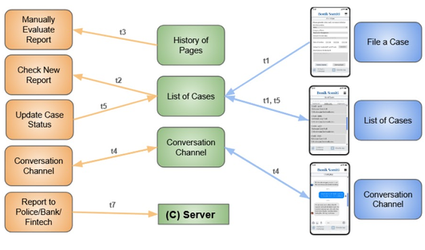
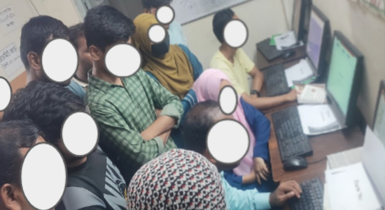
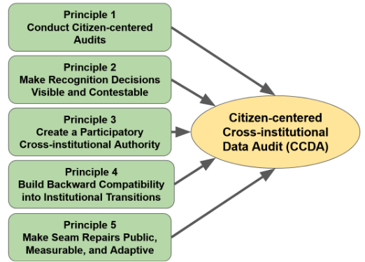

<h2>Data Repair</h2>

  

    
  

  

    
I study how data is repaired when it becomes inaccessible, damaged, or lost in low-resource contexts. Through ethnographic research with data repairers in Bangladesh, this project highlights the technical, social, and economic challenges shaping repair practices, including limited tools, knowledge barriers, and infrastructural constraints. This project calls for more equitable and context-aware approaches to data systems and technologies.

    
<strong>Publications:</strong> 
    [CHI'26] <a href="https://dl.acm.org/doi/pdf/10.1145/3772318.3790962">Data Repair</a> 🏆 Best Paper Honorable Mention 
    [arXiv] <a href="https://arxiv.org/abs/2606.03331">Evaluating LLMs' Effectiveness on Real-World Consumer Device Repair Questions</a>

  

<h2>AI for Informal E-market</h2>

  

    
  

  

    
I study how AI, platform algorithms, and community practices shape informal e-markets in the Global South. Through empirical studies, we developed the DAIEM framework to guide the design of decolonial AI for informal e-markets, and designed Bonik Somiti, a community-centered socio-technical system for fraud reporting, mediation, and accountability. Our work shows how AI can better support safe, trustworthy, and culturally grounded digital marketplaces.

    
<strong>Publications:</strong> 
    [DIS'26] <a href="https://dl.acm.org/doi/10.1145/3800645.3812955">Bonik Somiti: A Social-market Tool for Safe, Accountable, and Harmonious Informal E-Market Ecosystem in Bangladesh</a> 
    [COMPASS'26] <a href="https://arxiv.org/abs/2506.12910">DAIEM: Decolonizing Algorithm's Role as a Team-member in Informal E-market</a>

  

<h2>AI in Platform Labor</h2>

  

    
  

  

    
I study the digital and platform labor that makes AI systems possible. Workers on crowdsourcing and platform-based markets help train and maintain AI, yet they often remain invisible, underpaid, and unrecognized. This project highlights their challenges and everyday strategies, and calls for more fair and responsible AI and platform design.

    
<strong>Publications:</strong> 
    [COMPASS'26] <a href="https://arxiv.org/abs/2512.21649">'Ghostcrafting AI': Under the Rug of Platform Labor</a> 
    [arXiv] <a href="https://scholar.google.com/citations?view_op=view_citation&amp;hl=en&amp;user=4FqBS2QAAAAJ&amp;citation_for_view=4FqBS2QAAAAJ:LkGwnXOMwfcC">Digital labor: challenges, ethical insights, and implications</a>

  

<h2>Data Governance</h2>

  

    
  

  

    
I study how institutional policies, data standards, and governance practices affect citizens' access to digital services. Through interviews with 41 participants in Bangladesh, this project examines how data accepted by one institution may lose its value in another, creating challenges for citizens. We propose a citizen-centered approach to cross-institutional data auditing to improve accountability, coordination, and fairness in data governance.

    
<strong>Publications:</strong> 
    [arXiv] <a href="https://arxiv.org/abs/2609.28777">Data Patching</a>

  

<h2>AI in Farming</h2>

  

    
  

  

    
This project explores how technologies and local knowledge affect farmers' agricultural practices and interpretations of sustainability. Through empirical studies and participatory design, we investigate how farmers navigate misinformation and environmental challenges, and how emerging AI technologies can support their everyday farming needs.

  

